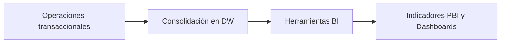
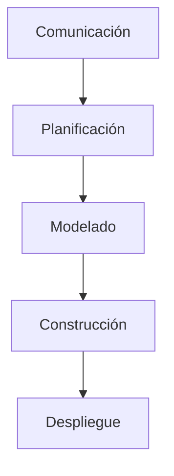
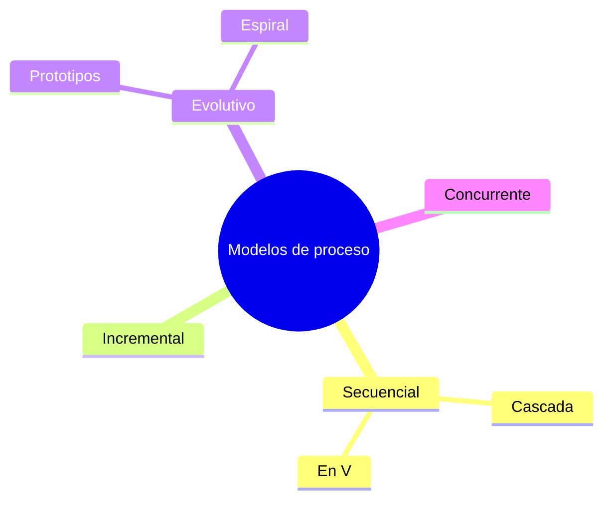
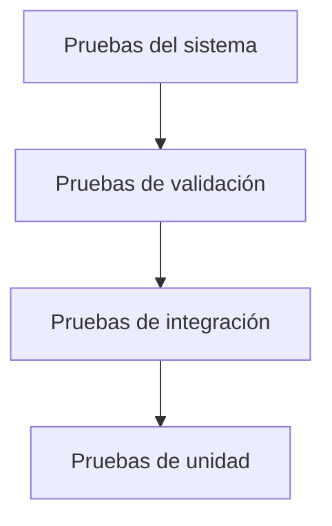
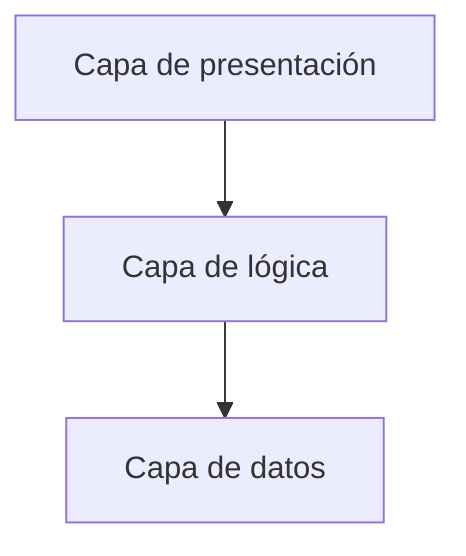
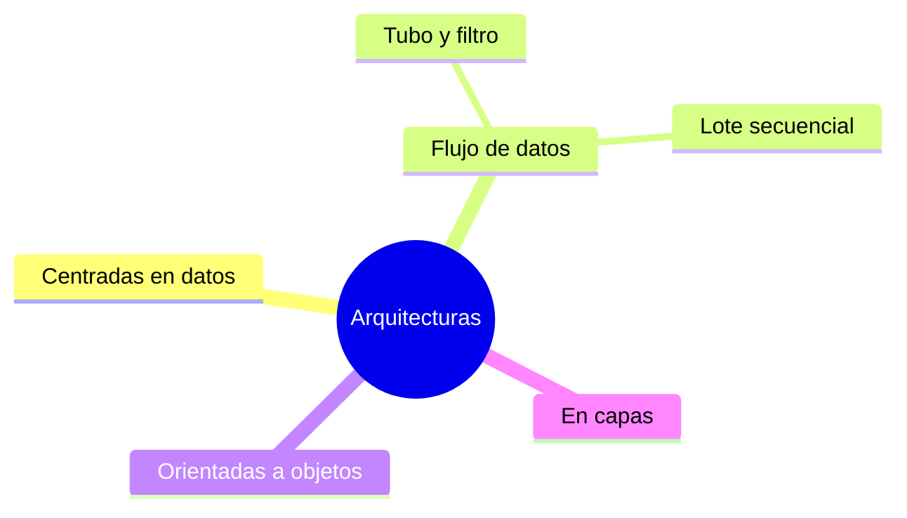
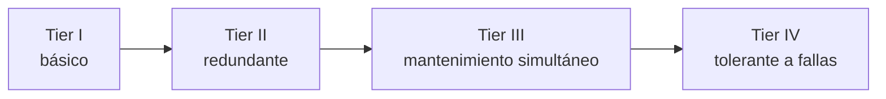
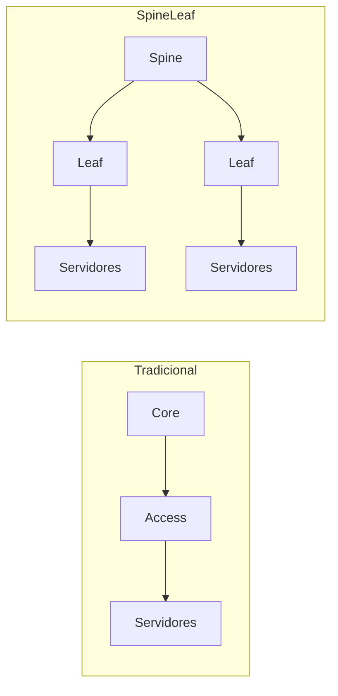
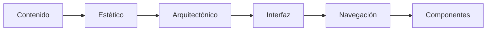

# Resumen para Parcial — Ingeniería de Software 2

> Material de estudio consolidado a partir de las clases (PDFs SW2 #1–#9, SW7, Ing. SW2 ppt5).

---

## 1. Introducción a Sistemas de Negocios (`SW2 #1`)

### Niveles de decisión y sistemas de información
- **Toma de decisiones**: estratégica, táctica, operativa.
- Los SI colaboran en los 3 niveles y evolucionan con intranets, web, e-commerce.
- **Sistemas ejecutivos de información**: fáciles de usar, información adaptada a preferencias del ejecutivo; factores de éxito crítico.
- **Sistemas de información administrativos**: reportes predefinidos (periódicos, excepcionales, bajo demanda, automáticos) → input de Tableros de Mando.
- **Portales de información/conocimiento empresarial**: interfaz web personalizada para intranets; acceso a apps, BD y servicios.

### Sistemas funcionales de negocio
Clasificación por tipo de aplicación:
- **Registros**: datos básicos (clientes, reclamos, atención).
- **Consumo**: bienes/servicios comercializados (facturadores).
- **Consolidación**: visión contable/financiera consolidada (ERP, SAP).
- **Presentación**: portales para clientes externos (home banking, consultas, pagos).
- **Decisiones**: alto grado de consolidación (tableros de mando, DW, datamining).

### Datawarehouse (DW)
- Repositorio que concentra el modelo de negocio de la empresa; visiones integradas para decisiones.
- Características clave: modelización del negocio, todas las variables, variable tiempo, captura vía ETL, ventanas de procesamiento.
- **Componentes**: ETL (Extracción, Transformación, Carga), Metadata (directorio de datos, trazabilidad), sistemas fuentes, accesos finales.
- DW vs bases transaccionales: tiempo (toda la historia vs presente), nivel de detalle, estabilidad, usuarios, complejidad de consultas, volumen, seguridad.

### Sistemas funcionales modernos
- Pasaje de monolíticos por área a ecosistemas de servicios (microservicios, APIs, cloud-native, BI, DevOps/SRE, metodologías ágiles).

---

## 2. Sistemas de Gestión (`SW2 #2`)

- Sistema de gestión empresarial: concentra info de todas las áreas y la convierte en **PBI** (Performance Business Indicators) medibles en tiempo real.
- Flujo: operaciones transaccionales → consolidación en DW → BI → indicadores y dashboards.
- **DataMining (DMM)** / Knowledge Discovery in Databases: extrae patrones ocultos y predice tendencias.
- **Cubos OLAP**: BD multidimensionales; consultas muy rápidas pero estructura rígida (rediseñar cubo para cambios).
- Herramientas: MIS Alea/Delta Miner, Contour Cube, Net Weaver BI, LGX OLAP, Onyx Analytics, Dundas OLAP.
- **GIS (Sistema de Información Geográfica)**: datos georreferenciados, capas, análisis espacial; integración con ERP/CRM/BI y dashboards geoespaciales.
- Evolución GIS: stand-alone → cliente-servidor → Web GIS → cloud/servicios (microservicios, DevOps) → data-driven/inteligente (Big Data, IoT, ML).
- Desarrollo para sistemas de gestión (BI, GIS, CRM, ERP): integrar datos, procesar/estructurar, presentar (dashboards/mapas), usabilidad y rendimiento.

---

## 3. Desarrollo de Tecnología en el SW (`SW2 #3`)

### Clasificación de tecnología
- **Base**: conocida por todos, no da ventaja competitiva pero es imprescindible.
- **Clave**: alto impacto competitivo, solo líderes la dominan.
- **Emergente**: en I+D, promete potencialidad.
- **Embrionaria**: investigación preliminar, aplicabilidad desconocida.

### Curva S de tecnología
- **Inicio**: rendimientos escasos, progreso lento.
- **Explosión**: rendimiento alto vs recursos, mejoras incrementales.
- **Madurez**: rendimiento no aumenta pese a más recursos.

### Planificación económica
- **Budget**: planificación de largo plazo, línea base.
- **Forecast**: proyección actualizada con info real, anticipa desvíos.

### Innovación e I+D
- Investigación básica, aplicada y desarrollo experimental.

### Desarrollo propio vs adquisición
- Propio: fortalecer I+D, RRHH, financiamiento; asume costos/riesgos.
- Adquisición: definir oportunidad, evaluar alternativas, identificar targets, valuación (DCF, múltiplos), due diligence, integración.

### Valuación y Business Case
- Métodos: balance, múltiplos, descuento de flujos, creación de valor, opciones.
- **Business Case**: evalúa viabilidad económica/estratégica; construye Flujo de Fondos (ingresos, costos de análisis/diseño/desarrollo/testing, infraestructura, implementación, operación, evolución, inversiones, RRHH).
- Indicadores: **VAN, TIR, Payback**, análisis de sensibilidad.
- Cuantificación: alcance, esfuerzo, recursos, horas/puntos de función, costos, plazos, inversiones, riesgos. "Lo que no se cuantifica, difícilmente puede planificarse."

### WACC y CAPM
- `WACC = Kd(1-Tc)(D/V) + Ks(S/V)`.
- `Ks = Rf + (Rm - Rf) * Beta` (CAPM). Beta mide riesgo no diversificable.

---

## 4. Procesos en el Desarrollo de Software (`SW2 #4`)

### Conceptos
- **Proceso**: conjunto de actividades, acciones y tareas para crear un producto de trabajo.
  - Actividad: objetivo amplio (comunicación).
  - Acción: conjunto de tareas (diseño de arquitectura).
  - Tarea: objetivo pequeño y bien definido (prueba unitaria).
- Proceso adaptable, no prescripción rígida. Ingeniería de software incluye tecnologías (métodos y herramientas) y personas.

### Framework Process (Pressman)
Actividades marco:
1. **Comunicación**
2. **Planificación**
3. **Modelado**
4. **Construcción**
5. **Despliegue**

### Modelos de proceso prescriptivo
- **Secuencial**: Cascada, en V.
- **Incremental**: secuencias lineales escalonadas, entregas rápidas.
- **Evolutivo**: prototipos, espiral (Boehm).
- **Concurrente**: elementos iterativos y concurrentes de cualquier modelo.
- Modelos especializados: basado en componentes, métodos formales, orientado a aspectos.

### Flujos de proceso
- Lineal, iterativo, evolutivo, paralelo.

---

## 5. Principios del desarrollo de SW (`Ing. SW2 ppt5`)

### Principios de planeamiento (10)
Entender alcance; involucrar participantes; iteratividad; estimar con base en lo que se sabe; considerar riesgos; ser realista; granularidad; asegurar calidad; manejar cambio; dar seguimiento y ajustar.

### Principios de construcción (10)
Elaborar software no modelos; "viajar ligero"; modelo más sencillo; susceptibles al cambio; propósito explícito; adaptar modelos; rendimientos decrecientes; no dogmático con sintaxis; confiar en instinto; retroalimentación temprana.

### Conceptos subyacentes
- Modelado = análisis + diseño.
- Construcción = codificación + pruebas (unitaria, integración, validación, aceptación).
- Despliegue = entrega, apoyo, retroalimentación.

### Principios básicos de diseño
- Diseño transforma modelos de requerimientos en 4 modelos: datos/clases, arquitectura, interfaz, componentes.
- **Clases de diseño** (5): interfaz de usuario, dominio de negocios, proceso, persistentes, sistemas.
- **Primitivismo**, **cohesión**, **acoplamiento**.
- **Lineamientos de diseño** (8) y características de calidad: usabilidad, confiabilidad, rendimiento, mantenibilidad.

### Síntesis de diseño
Elementos: arquitectónico, de interfaz, de componentes, de despliegue.

---

## 6. Diseño de Interfaz y Patrones (`SW2 #6`)

### Reglas doradas de la interfaz
1. **Dejar el control al usuario** (interacción flexible, reversible, personalizable, ocultar tecnicismos, interacción directa).
2. **Reducir la carga de memoria** (memoria de corto plazo, defaults significativos, atajos intuitivos, metáfora del mundo real, revelar progresivamente).
3. **Consistencia** (contexto significativo, consistencia en familia de apps, no cambiar sin razón ineludible).

### Modelos de interfaz
- **Modelo de usuario** (perfil), **modelo del diseño** (ingeniero), **modelo mental** (imagen del usuario), **modelo de implementación** (manifestación externa + info de apoyo).

### Proceso de diseño de interfaz
- Análisis (usuario, tarea, ambiente) → Diseño (objetos y acciones) → Construcción (prototipos) → Validación (requerimientos, usabilidad, aceptación).

### Principios generales para webapps
Previsión, comunicación, consistencia, autonomía controlada, eficiencia, flexibilidad, centrarse, Ley de Fitt, objetos de interfaz humana, reducción de latencia, aprendizaje, metáforas, integridad de productos del trabajo, legibilidad, seguimiento del estado, navegación visible.

### Diseño basado en patrones
- Patrón describe problema, contexto, sistema de fuerzas y solución.
- Lenguajes de patrón y repositorios (índice + hipervínculos).
- **Patrones arquitectónicos**: control de acceso, concurrencia, distribución, persistencia.
- **Patrones a nivel de componentes**: AdvancedSearch, HelpWizard, SearchArea, SearchTips, SearchResults, SearchBox.
- **Patrones de diseño de interfaces**: ShoppingCart, ProgressIndicator, EditInPlace, BreadCrumbs.
- **Patrones de webapps**: por nivel de atención (arquitectura de información, navegación, interacción, presentación, funcionales) y por granularidad (arquitectónicos, de diseño, de componentes).

---

## 7. Datacenter (`SW2 #7BIS`)

### Tipos de datacenter
- **Enterprise** (en las instalaciones, control de seguridad).
- **Cloud/Hyperscale** (recursos compartidos para múltiples clientes).
- **Gestionados/Telco/Collocation** (infraestructura de operador).
- **Edge** (borde de la red, alta capacidad de gestión).

### Estándares
- **ANSI/TIA-942** (América del Norte), **EN-50600** (Europa).
- Elementos funcionales: diseño, refrigeración, seguridad, sustentabilidad.

### Aspectos de diseño
- Uso eficiente de energía, escalabilidad, cadena de suministro.

### Clasificación Tier (UpTime Institute)
| Tier | Característica |
|------|----------------|
| I | Capacidades básicas; paradas para mantenimiento |
| II | Componentes redundantes; N+1 UPS/generador |
| III | Mantenimiento simultáneo; vías redundantes |
| IV | Tolerante a fallas; mantenimiento simultáneo |

### Conectividad
- Roadmap Ethernet (10G → 800G+).
- Arquitecturas: tradicional (switching) vs **Spine & Leaf** (menor latencia este-oeste, más resiliente, más ancho de banda).
- Redes para IA (Gen AI): back-end nuevo + front-end existente.

### Tendencias
- Movimiento hacia infraestructura en la nube, mayores capacidades y velocidades.

---

## 8. Diseño WebApps y Calidad (`SW2 #8`)

### Diseño WebApp (6 etapas)
1. Diseño del contenido.
2. Diseño estético (vista y sensación).
3. Diseño arquitectónico (estructura de hipermedios).
4. Diseño de la interfaz (distribución, mecanismos).
5. Diseño de la navegación (flujo entre objetos).
6. Diseño de componentes (estructura interna detallada).

### Principios fundamentales
- Consistencia (navegación, colores, organización visual); simplicidad; retroalimentación inmediata; minimizar sobrecarga cognitiva.
- Arquitectura en capas: presentación, lógica, datos; desacoplamiento.

### Interfaz y accesibilidad
- Objetivos: ventana congruente, guiar interacción, organizar navegación.
- Mecanismos de navegación: menús, iconos gráficos, imágenes.
- Accesibilidad: usabilidad para todos, estándares, lectores de pantalla.

### Contenido, navegación, formularios, seguridad, responsive
- Contenido: lógico y jerárquico, relevante, sin redundancias.
- Navegación: intuitiva, consistente, menús estratégicos, orientación del usuario.
- Formularios: validación cliente y servidor, mensajes descriptivos.
- Seguridad: autenticación, autorización, prevención SQL Injection/XSS.
- Responsive: adaptación a distintos tamaños de pantalla.

### Pruebas y patrones
- Pruebas: navegación, interfaz, usabilidad; funcionales y UX.
- Patrones: MVC (separa interfaz, lógica, datos) → mejor organización, mantenimiento, trabajo paralelo, escalabilidad.
- Método MDHOO (Diseño de Hipermedios Orientado a Objetos).

### Calidad (Pressman / Garvin / ISO 9126)
- Calidad = cumplir requisitos funcionales y no funcionales; satisfacción del cliente.
- **Dimensiones de Garvin** (8): desempeño, características, confiabilidad, conformidad, durabilidad, servicio, estética, percepción.
- **ISO 9126** (6 atributos): funcionalidad, confiabilidad, usabilidad, eficiencia, mantenibilidad, portabilidad.
- **Costo de la calidad**: prevención, evaluación, falla (interna/externa).

---

## 9. Técnicas de revisión, SQA y pruebas (`SW2 #9`)

### Revisión técnica
- Objetivo: detectar errores lo antes posible (amplificación del defecto).
- Costos relativos de corregir: diseño 1,5 UC; antes de pruebas 6,5 UC; durante pruebas 15 UC; después de entrega 67 UC.
- Sin revisiones ≈ 3× más caro que con revisiones.

### Tipos de revisión
- **Informales**: verificación de escritorio, reuniones casuales.
- **Programación en parejas**: revisión continua, detección inmediata de errores.
- **RTF (Revisión Técnica Formal)**: reunión estilizada con roles definidos, agenda, lineamientos (10), registros.
- **Revisiones por muestreo**: cuando no hay recursos para todas; muestrear para identificar productos con mayor probabilidad de errores.

### SQA (Aseguramiento de la Calidad del Software)
- Mapeo de preceptos administrativos y disciplinas de diseño.
- 4 pasos: definir "calidad"; crear actividades; desarrollar control de calidad; usar métricas.
- **Elementos**: estándares; revisiones/auditorías; pruebas; colección y análisis de errores; gestión del cambio; educación; proveedores; seguridad; riesgos.
- **Tareas**: plan de SQA, participación en descripción del proceso, verificación de cumplimiento, auditoría de productos, documentación de desviaciones, registro de incumplimientos.
- **Metas**: calidad de requerimientos, diseño, código, eficacia del control de calidad.
- **Aseguramiento estadístico**: recabar/clasificar errores → rastrear causas → Pareto (80/20) → corregir causas.
- **Confiabilidad del software**: probabilidad de operar sin fallas en ambiente/tiempo específico.

### Plan de SQA (estructura IEEE)
Propósito y alcance; productos del trabajo; normas y prácticas; acciones y tareas; herramientas y métodos; gestión de configuración; salvaguardas y registros; roles y responsabilidades.

### Normas
- **ISO 9000**: familia, fundamentos, vocabulario de SGC.
- **ISO 9000:2015**: elementos generales de aseguramiento de calidad.
- **ISO 9001:2015**: requerimientos (responsabilidad de administración, sistema de calidad, revisión de contrato, control de diseño, documentación, identificación/seguimiento, control de proceso, inspección/pruebas, acciones correctivas/preventivas, registros, auditorías internas, capacitación, servicio, técnicas estadísticas).

### Estrategias de prueba
- Objetivo: descubrir errores.
- **Pasos**: unidad → integración → validación → sistema.
- **Prueba de unidad**: interfaz del módulo, datos locales, rutas independientes, condiciones de frontera, manejo de errores. Entorno: controladores (programa principal de prueba) y representantes (stubs).
- **Prueba de integración**: descendente (primero en profundidad/anchura) y ascendente (grupos de componentes).
- **Pruebas OO**: prueba de clase (equivalente a unidad); integración basada en hebra (conjunto de clases para responder a un evento) o basada en uso (capas de clases dependientes).
- **Validación**: prueba alfa (sitio del desarrollador, ambiente controlado) y beta (sitio del usuario, ambiente no controlado).
- **Pruebas del sistema**: recuperación, seguridad, esfuerzo, rendimiento, despliegue.

### Depuración
- Relacionar síntoma con causa; corregir.
- Estrategias: fuerza bruta (masa de info), backtracking (rastrear hacia atrás), eliminación de causas (Pareto/hipótesis).

---

## 10. Diseño de Arquitecturas (`SW7`)

### Conceptos
- Diseño = proceso multi-etapa: requerimientos → datos, estructura del programa, interfaz, procedimientos.
- La arquitectura no es el software operativo; permite analizar efectividad, considerar alternativas, reducir riesgos.
- Componente de software: módulo/clase, BD, middleware; propiedades (interacción), relaciones (invocación, protocolo).

### Importancia
- Comunicación entre participantes; primeras decisiones con efecto profundo; modelo intelectualmente asequible; transferibilidad de patrones.

### Descripción arquitectónica (IEEE-Std-1471-2000)
- DA = conjunto de productos para documentar una arquitectura.
- Perspectivas múltiples, cada una desde un punto de vista (convenciones).
- Decisiones arquitectónicas documentadas (racionalidad y registro histórico).

### Géneros arquitectónicos
IA, comerciales/no lucrativos, comunicaciones, contenido de autor, dispositivos, entretenimiento/deportes, financieros, juegos, gobierno, industrial, legal, médicos, militares, sistemas operativos, plataformas, científicos, herramientas, transporte, utilidades.

### Taxonomías arquitectónicas
- **Centradas en datos**: repositorio central; cliente accede; variante "pizarrón" con notificaciones.
- **Flujo de datos**: tubo y filtro (filtros independientes conectados por tubos); lote secuencial.
- **Orientadas a objetos**: componentes con datos + operaciones; comunicación por mensajes.
- **En capas**: capas con operaciones que se aproximan a instrucciones de máquina.

### Diseño arquitectónico (4 pasos)
1. Representar en contexto (entidades externas e interacción).
2. Identificar arquetipos (abstracciones de comportamiento).
3. Identificar componentes dentro de una arquitectura de soporte.
4. Desarrollar instancias para probar el diseño en el mundo real.
- Mapeo de transformación: DFD → estructura del programa (control a entrada, procesamiento, salida).

### Diseño a nivel de componente
- **ISBC** (Ingeniería de Software Basada en Componentes): reutilización organizada.
- Principios: **abstracción**, **modularidad**, **encapsulamiento**, **independencia funcional**, **cohesión** (funcional, de capa, de comunicación), **acoplamiento** (bajo = deseable).
- **Diseño OO**: clases con atributos y métodos; responsabilidad única; interfaces (abstracción, bajo acoplamiento, polimorfismo).
- Refinamiento iterativo: visión general → especificación detallada; herramientas UML, pseudocódigo, diagramas de flujo.
- **Patrones de diseño**: creacionales (creación de objetos), estructurales (organización), comportamiento (comunicación/interacción).
- Conclusiones: diseño reduce abstracción hasta nivel cercano al código; 3 tipos de componentes: control, dominio del problema, infraestructura.

---

## 11. Diagramas de ayuda (Mermaid)

### Curva S de tecnología

### Flujo de datos en un sistema de gestión

### Actividades marco del Framework Process

### Modelos de proceso prescriptivo

### Pirámide de pruebas

### Arquitectura en capas (WebApp)

### Taxonomías arquitectónicas

### Clasificación Tier de datacenters

### Red Spine & Leaf vs tradicional

### Flujo de diseño WebApp

---

## 12. Imágenes sugeridas para agregar

> Los PDFs originales contienen las figuras; captúralas y referéncialas aquí.

- Curva S de tecnología — `SW2 #3`.
- Mapa de sistemas funcionales de negocio — `SW2 #1`.
- Componentes del Datawarehouse (ETL, metadata) — `SW2 #1`.
- Cubos OLAP — `SW2 #2`.
- Mapa GIS (capas) — `SW2 #2`.
- Framework Process — `SW2 #4`.
- Modelos de proceso (cascada, V, espiral, incremental) — `SW2 #4`.
- Modelos de interfaz — `SW2 #6`.
- Tabla de organización de patrones — `SW2 #6`.
- Esquema de distribución de un DC — `SW2 #7BIS`.
- Clasificación Tier I–IV — `SW2 #7BIS`.
- Topología Spine Leaf 100G — `SW2 #7BIS`.
- Pirámide de diseño WebApp — `SW2 #8`.
- Dimensiones de calidad de Garvin — `SW2 #8`.
- Modelo de amplificación del defecto — `SW2 #9`.
- RTF (roles y lineamientos) — `SW2 #9`.
- Plan de SQA (estructura IEEE) — `SW2 #9`.
- Taxonomías arquitectónicas — `SW7`.
- Arquetipos y mapeo de transformación — `SW7`.

---

## Glosario rápido de conceptos clave

| Concepto | Definición corta |
|----------|------------------|
| Framework Process | Actividades marco: comunicación, planificación, modelado, construcción, despliegue |
| DW | Repositorio integrado para decisiones; ETL + metadata |
| PBI | Indicadores clave de desempeño |
| DMM | Extracción de patrones ocultos en BD |
| GIS | Sistema de información geográfica |
| Budget/Forecast | Planificación largo plazo / proyección actualizada |
| WACC | Tasa promedio ponderada del costo de capital |
| CAPM | Modelo de fijación de precios de activos de capital |
| Business Case | Evaluación de viabilidad económica de un producto de SW |
| RTF | Revisión técnica formal |
| SQA | Aseguramiento de la calidad del software |
| MVC | Modelo-Vista-Controlador |
| Tier | Clasificación de datacenters por disponibilidad |
| Spine & Leaf | Arquitectura de red con baja latencia este-oeste |
| ISBC | Ingeniería de software basada en componentes |
| MDHOO | Método de diseño de hipermedios orientado a objetos |

---

## 13. Preguntas de parcial (con respuesta)

### Bloque A

**1) ¿Cómo se fue dando la evolución de los sistemas de gestión hasta llegar a los dashboards? Justifique.**
Los sistemas de gestión pasaron de ser aplicaciones aisladas por área (finanzas, ventas, RRHH) a sistemas integrados (ERP) que concentran información de todas las áreas funcionales. Luego se incorporó la generación de **PBI (indicadores clave de desempeño)** a partir de los datos operativos, consolidados en **Datawarehouses** y procesados por herramientas de **BI**. Finalmente surgieron los **dashboards ejecutivos**, que presentan la información de manera visual y sintética (gráficos, tablas dinámicas, alertas) para decisiones ágiles. Flujo: operaciones transaccionales → consolidación en DW → BI → indicadores y dashboards.

**2) Explique las taxonomías arquitectónicas en el desarrollo de SW.**
- **Centradas en datos**: repositorio central (archivo/BD) al que acceden componentes que actualizan/modifican datos; variante "pizarrón" que notifica cambios.
- **Flujo de datos**: datos de entrada se transforman en salida mediante componentes; patrón tubo y filtro (filtros independientes conectados por tubos) o lote secuencial.
- **Orientadas a objetos**: componentes incluyen datos + operaciones; comunicación por mensajes.
- **En capas**: capas con operaciones que se aproximan progresivamente a instrucciones de máquina.

**3) Desarrolle el concepto de Des. Aplicaciones WEB, Calidad, Pruebas, Planificación, etc.**
El diseño de WebApps incluye 6 etapas: contenido, estético, arquitectónico, interfaz, navegación y componentes. Se rige por principios: consistencia, simplicidad, retroalimentación inmediata, minimizar sobrecarga cognitiva, arquitectura en capas y desacoplamiento. La calidad abarca rendimiento, disponibilidad y seguridad; dimensiones de Garvin e ISO 9126. Las pruebas (navegación, interfaz, usabilidad, funcionales, UX) detectan problemas antes de implementar. El diseño se apoya en patrones (MVC) y métodos como MDHOO, y se integra con Scrum para desarrollo iterativo.

**4) Detallar las características de los modelos de procesos en Cascada y en V. Justifique.**

Son enfoques secuenciales de gestión de proyectos y desarrollo de software

- **Cascada**:

• Funcionamiento: Divide el proyecto en fases secuenciales donde cada etapa debe completarse antes de iniciar la siguiente, con fuerte énfasis en la documentación y los hitos.

• Fases habituales: Análisis de requisitos, diseño, implementación, verificación/pruebas y mantenimiento.

• Ventajas: Estructura simple, planificación predecible y facilidad para estimar tiempos y costos iniciales.

• Desventajas: Poca flexibilidad ante cambios tardíos y detección tardía de errores si las pruebas se concentran al final.

- **En V**:
  
• Parte de una base secuencial similar a la cascada, pero adopta forma de "V". El lado izquierdo define requisitos y diseños, la base corresponde a la codificación/implementación, y el lado derecho ejecuta las pruebas correspondientes a cada nivel superior.

• Correspondencia de pruebas:

	• Requisitos \(\leftrightarrow \) Pruebas de aceptación.
	
	• Diseño del sistema / arquitectura \(\leftrightarrow \) Pruebas del sistema.
	
	• Diseño detallado / módulos \(\leftrightarrow \) Pruebas de integración y pruebas unitarias.
	
• Ventajas: Integra la calidad desde etapas tempranas, aclara el alcance de las pruebas y facilita detectar inconsistencias antes de avanzar.

• Desventajas: Mantiene una rigidez secuencial alta y resulta costoso si los requisitos cambian con frecuencia durante el proyecto.

Mientras que el modelo en cascada suele concentrar la validación hacia el tramo final del ciclo, el modelo en V diseña las pruebas en paralelo 

**5) Explique las generalidades de SCRUM y KANBAN Técnico. Diferencias y tendencias.**

Scrum organiza personas, tareas, tiempos, entregas y prioridades; desarrolla WebApps de forma iterativa, con sprints que entregan incrementos funcionales, feedback continuo, prototipos para validación temprana. Kanban técnico se basa en visualizar el flujo de trabajo, limitar trabajo en progreso (WIP) y gestionar flujo continuo. Diferencias: Scrum tiene roles, sprints fijos y ceremonias; Kanban es más flexible, sin iteraciones fijas, enfocado en flujo y mejora continua. 

Tendencia: combinación de ambos (Scrumban) y adopción de prácticas ágiles en entornos de alta incertidumbre.

**6) Explique los conceptos de Gestión de Tecnologías de SW, curva S y estadios. ¿Cómo esto se concatena con un proceso de evolución en el desarrollo de SW? Justifique.**

Curva S: Modela el rendimiento de una tecnología en función del esfuerzo o inversión. 

La gestión de tecnología clasifica tecnologías en base, clave, emergente y embrionaria. La **curva S** describe su evolución: 

**Inicio** (rendimientos escasos, progreso lento)

**Explosión** (rendimiento alto vs recursos, mejoras incrementales)

**Madurez** (rendimiento no aumenta pese a más recursos) 

**Obsolescencia**

Concatenación: Al llegar a la meseta, el software basado en esa tecnología se vuelve obsoleto, obligando a refactorizar o migrar a una nueva Curva S tecnológica. 

**7) Sintetizar los principios básicos que rigen el planeamiento en el desarrollo de SW.**

Entendimiento del Alcance y Descomposición: Dividir un problema complejo en partes manejables mediante la estructura de descomposición de trabajo (WBS / EDT), identificando claramente entregables y límites del proyecto. 

Estimación Realista y Basada en Datos: Evitar estimaciones basadas en presiones políticas o deseos, utilizando métricas históricas, puntos de historia, analogías o modelos paramétricos (ej. COCOMO). 

Identificación y Gestión Proactiva de Riesgos: Anticipar los factores de incertidumbre técnica, de recursos o de negocio, priorizándolos y diseñando planes de mitigación antes de que impacten en el cronograma. 

Flexibilidad y Adaptabilidad: Reconocer que los planes no son estáticos; deben ajustarse de manera iterativa frente a cambios de requerimientos o hallazgos técnicos (principio rector de la agilidad). 

Definición de Hitos Claros y Medibles: Establecer puntos de control concretos basados en entregas de software funcionando y validado, en lugar de métricas basadas puramente en la cantidad de documentación redactada o horas hombre consumidas. 

### Bloque B (estilo examen)

**1) Explicar las diferencias entre un Datawarehouse y Bases de Datos Transaccionales.**

Bases de Datos Transaccionales (OLTP): 

Objetivo: Automatizar y registrar operaciones cotidianas de la operativa diaria (ej. altas, bajas, modificaciones de stock, transacciones bancarias). 

Modelado: Estructuras fuertemente normalizadas para evitar redundancias y garantizar consistencia  (ACID). 

Carga de trabajo: Alta concurrencia de lecturas y escrituras pequeñas y rápidas. 

Data Warehouse (OLAP): 

Objetivo: Consolidar información histórica de múltiples fuentes heterogéneas para el análisis estratégico y la toma de decisiones gerenciales. 

Modelado: Estructuras desnormalizadas orientadas a dimensiones (esquemas en estrella o copo de nieve) para optimizar el rendimiento de las consultas complejas. 

Carga de trabajo: Consultas masivas de lectura, agregaciones y escaneos de grandes volúmenes de datos, alimentados periódicamente mediante procesos ETL (Extracción, Transformación y Carga). 

\

**2) Explicar el concepto de "Knowledge Discovery in Database" que forma parte del concepto de Datamining.**

El KDD (Knowledge Discovery in Databases) es el proceso completo y sistemático para extraer conocimiento útil, válido y comprensible a partir de grandes bases de datos.

El Data Mining es sólo una etapa central dentro del macroproceso de KDD. Las fases que componen el KDD son: 

Limpieza e Integración: Eliminación de ruido, tratamiento de valores faltantes y unificación de datos de diversas fuentes. 

Selección y Transformación: Reducción de dimensionalidad y preparación de los datos en un formato apto para el análisis. 

Minería de Datos (Data Mining): Aplicación de algoritmos computacionales y estadísticos (clasificación, clustering, reglas de asociación, árboles de decisión) para extraer patrones o modelos ocultos. 

Interpretación y Evaluación: Análisis de los patrones obtenidos para transformarlos en conocimiento de negocio accionable, evaluando su validez y utilidad. 

\n

**3) Explicar el concepto y funcionamiento de los cubos OLAP.**

Son bases de datos multidimensionales almacenadas físicamente como vectores multidimensionales; se accede indexando por valores de dimensiones/ejes. Consultas de selección muy rápidas (casi tiempo real), pero una vez poblado el cubo no puede cambiar su estructura sin rediseñarlo.

A diferencia de las bases de datos relacionales tradicionales donde las consultas complejas requieren unir múltiples tablas en tiempo de ejecución, el cubo OLAP precalcula y preagrega las intersecciones de las dimensiones de antemano (almacenando los resultados en celdas del hipercubo).

\

**4) Explicar los conceptos relacionados a los sistemas de información GIS.**

Un GIS (Sistema de Información Geográfica) es un conjunto integrado de hardware, software y datos diseñado para capturar, almacenar, manipular, analizar y desplegar información geográficamente referenciada. Sus conceptos clave incluyen: 

Dato Espacial (Georreferenciación): Información asociada a una posición física en la superficie terrestre mediante coordenadas (latitud/longitud o sistemas proyectados como UTM). 

Modelos de Datos Geográficos: 

Modelo Vectorial: Representa el mundo real mediante elementos geométricos discretos: puntos (ej. torres de alta tensión), líneas (ej. rutas, ríos) y polígonos (ej. límites de parcelas, provincias). 

Modelo Raster: Representa el espacio mediante una malla o matriz regular de celdas (píxeles), donde cada celda almacena un valor numérico (ej. imágenes satelitales, modelos digitales de elevación). 

Capas de Información (Layers): Superposición lógica de diferentes temas geográficos (hidrografía, red vial, densidad poblacional, catastros) sobre un sistema de coordenadas común para efectuar análisis espaciales de proximidad, intersección o ruteo óptimo. 

**5) Explicar los 4 estadios de la Curva de Evolución Tecnológica.**

Estadío de Emergencia / Introducción (I+D): La tecnología surge de la investigación inicial. Presenta altísima incertidumbre, costos elevados y un rendimiento bajo, limitado a laboratorios y prototipos conceptuales. 

Estadío de Crecimiento Acelerado (Auge): La tecnología demuestra su viabilidad técnica y comercial. Se estandarizan sus componentes, aumentan drásticamente las inversiones, su rendimiento crece de manera exponencial y su adopción se masifica en la industria. 

Estadío de Madurez / Meseta (Slat): La tecnología alcanza los límites físicos o conceptuales de su arquitectura actual. El rendimiento se estabiliza, la competencia se traslada a la reducción de costos y optimización marginal, y el mercado se satura. 

Estadío de Obsolescencia / Declive: La tecnología es superada por una innovación disruptiva (una nueva Curva S). Su rendimiento relativo se vuelve insuficiente frente a las nuevas demandas del mercado, iniciándose su reemplazo sistemático. 

**6) Explicar los modelos de Desarrollo Incremental y Fundamental del I+D.**

La I+D (Investigación y Desarrollo) es el conjunto de actividades creativas y sistemáticas que realiza una empresa o institución para aumentar el conocimiento y utilizarlo para crear nuevos productos, procesos o servicios, o para mejorar los que ya existen.

1. Modelo de Desarrollo Incremental

Consiste en realizar mejoras pequeñas, continuas y progresivas sobre un producto, servicio o proceso que ya existe en el mercado. No cambia la esencia del producto, sino que lo optimiza.

• Objetivo: Aumentar la eficiencia, reducir costos, corregir fallos o añadir funciones que los clientes actuales demandan.

• Nivel de riesgo e inversión: Bajo.

• Tiempo de retorno: Corto plazo.

• Ejemplos: El lanzamiento anual de un teléfono inteligente con mejor cámara y batería, una actualización de software que mejora la velocidad, o una fórmula de detergente más concentrada.

2. Modelo de Desarrollo Fundamental (o Radical)

Consiste en la creación de tecnologías, productos o modelos de negocio completamente nuevos que rompen con lo establecido y pueden llegar a crear mercados inexistentes o reemplazar por completo a los actuales.

• Objetivo: Generar un avance disruptivo basado en nuevos descubrimientos científicos o tecnológicos.

• Nivel de riesgo e inversión: Muy alto. Requiere mucha investigación básica, capital intensivo y existe alta incertidumbre sobre su éxito técnico y comercial.

• Tiempo de retorno: Largo plazo.

• Ejemplos: La invención de la inteligencia artificial generativa, el desarrollo de las vacunas de ARN mensajero, los vehículos autónomos o la transición de la fotografía analógica a la digital.

**7) Explicar el concepto de la WACC y como influye en el VNA de un flujo de fondo de un proyecto de inversión.**

WACC es la tasa promedio ponderada del costo de capital. Representa la tasa de rendimiento mínima que una empresa debe generar para satisfacer a todos sus proveedores de fondos. Se usa como tasa de descuento en el flujo de fondos del Business Case para calcular el VAN;

VNA: valor neto actual.  si el VAN > 0, el proyecto es viable. Refleja el costo de financiamiento (deuda + capital propio) después de impuestos.

.

**8) Explicar los modelos de procesos en "Cascada" y en "V".**
Ver pregunta 4 del Bloque A (mismo contenido).

.

**9) Explicar los modelos de procesos en "Evolutivo" y en "Espiral".**

- **Evolutivo**:El modelo evolutivo se caracteriza por ser iterativo y permitir que el software crezca y cambie a medida que se comprenden mejor los requisitos.

• Funcionamiento: Se desarrolla una versión inicial del sistema, se muestra al usuario y se refina en ciclos sucesivos según sus comentarios o nuevos requerimientos.

• Cuándo usarlo: Es útil cuando los requisitos iniciales son difusos, cambian con frecuencia o el cliente necesita probar versiones tempranas para definir qué desea.
  
- **Espiral (Boehm)**: Es un modelo de procesos orientado al riesgo, propuesto por Barry Boehm, que combina la naturaleza iterativa del prototipado con los aspectos controlados y sistemáticos del modelo en cascada. El desarrollo se representa como una espiral donde cada bucle o iteración representa una fase del proyecto, estructurada en cuatro sectores principales: 

Determinación de objetivos, alternativas y restricciones. 

Análisis de riesgos (identificación y evaluación de incertidumbres tecnológicas o de negocio). 

Desarrollo y validación (construcción del incremento del producto mediante ingeniería). 

Planificación de la siguiente fase. 

• Funcionamiento: El proceso avanza en espiral a través de ciclos o iteraciones. En cada vuelta se refina el grado de definición del sistema y se entrega una versión más completa.

• Cuándo usarlo: Es ideal para sistemas grandes, complejos o críticos donde los errores o fallos son costosos y requieren evaluación continua de riesgos.

.

**10) Citar los principios básicos en el Diseño de SW moderno.**

Los principios fundamentales que guían un diseño de software robusto, mantenible y escalable son: 

1- *Modularidad*: Descomponer el sistema en partes discretas (módulos) con alta cohesión interna y bajo acoplamiento externo. 

2- *Abstracción y Ocultamiento de Información*: Permitir trabajar con conceptos complejos ocultando los detalles internos de implementación mediante interfaces claras. 

3- *Separación de Intereses (Separation of Concerns)*: Dividir un programa en secciones distintas donde cada una aborda un concepto o área de negocio separada. 

4- *Independencia Funcional*: Maximizar la cohesión de cada módulo y minimizar las interdependencias entre ellos. 

5- *Reutilización*: Diseñar componentes orientados a ser reutilizados en diferentes contextos o sistemas, reduciendo redundancias. 

6- *Simplicidad*: Evitar la sobrediseño; mantener la arquitectura y el código tan simples como sea funcionalmente posible. 

.

**11) Citar los objetivos básicos que rigen a las "Descripciones Arquitectónicas".**

Una descripción arquitectónica (AD) es una representación estructurada de un sistema de software que cumple con los siguientes objetivos básicos: 

1- Facilitar la comprensión de la estructura general del sistema y de cómo interactúan sus componentes de alto nivel. 

2- Servir como medio de comunicación efectivo entre todos los interesados (stakeholders) 

3- Permitir la evaluación y análisis temprano de las cualidades del sistema (escalabilidad, rendimiento, seguridad, modificabilidad)

4- Guiar la construcción y el despliegue del software.

**12) Citar al menos 5 géneros arquitectónicos dentro del marco de las Descripciones Arquitectónicas.**

.

1 -Arquitectura por Capas (Layers): Organización jerárquica en bandas horizontales (Presentación, Negocio, Persistencia). 

2- Arquitectura Orientada a Servicios (SOA) / Microservicios: Sistemas descompuestos en servicios independientes que se comunican mediante redes y protocolos estándar. 

3- Arquitectura Basada en Eventos (Event-Driven): Estructura basada en la producción, detección y consumo asíncrono de eventos a través de brokers o colas de mensajes. 

4- Arquitectura de Tuberías y Filtros (Pipes and Filters): Componentes independientes (filtros) que transforman flujos de datos recibidos a través de canales secuenciales (tuberías). 

5- Arquitectura Cliente-Servidor: Separación entre nodos que proveen recursos o servicios (servidores) y aquellos que los solicitan (clientes). 

.

.

**13) Explicar el Diseño basado en Patrones vs. el Diseño Basado en Estructuras.**

- **Diseño Basado en Estructuras**: Se enfoca en organizar los datos y los procedimientos lógicos del sistema utilizando jerarquías tradicionales (como descomposición modular funcional, árboles de llamadas o diagramas entidad-relación). Busca definir la arquitectura desde un enfoque estructural rígido descendente (top-down).
- 
- **Diseño Basado en Patroness**: Se fundamenta en la reutilización de soluciones comprobadas y estandarizadas (Design Patterns, patrones arquitectónicos, patrones de webapps) para resolver problemas recurrentes en el diseño de software. En lugar de diseñar desde cero, el ingeniero identifica el contexto del problema y aplica soluciones abstractas probadas (ej. Singleton, MVC, Factory, Observer), acelerando el desarrollo y mejorando la calidad estructural y la legibilidad del sistema. 

.

**14) Citar los 5 principios fundamentales que rigen el diseño de WEBApps.**

a) Simplicidad: Minimizar la sobrecarga visual y cognitiva del usuario, priorizando la claridad del contenido y la navegación intuitiva. 

b) Consistencia: Mantener patrones uniformes en la interfaz, tipografías, flujos de navegación y respuestas en todo el sitio o aplicación. 

c) Movilidad y Adaptabilidad (Responsive Design): Asegurar que la WebApp se adapte fluidamente a diferentes tamaños de pantalla, resoluciones y dispositivos (móviles, tablets, escritorios). 

d) Robustez y Seguridad : Proteger la aplicación frente a vulnerabilidades web comunes (como inyecciones, ataques XSS, validaciones de formularios robustas) y garantizar alta disponibilidad. 

e) Identidad y Estética (Identity): Reflejar fielmente la identidad visual y la propuesta de valor de la organización o producto a través del diseño. 

.

**15) Explicar las "Dimensiones de Calidad" en el marco de los procesos de Calidad asociados al SW.**

Las 8 dimensiones de Garvin:

desempeño, características, confiabilidad, conformidad, durabilidad, servicio, estética y percepción. Complementadas por ISO 9126 (funcionalidad, confiabilidad, usabilidad, eficiencia, mantenibilidad, portabilidad). La calidad tiene costo (prevención, evaluación, falla).

**16) Explicar los conceptos de Prueba de Unidad y Pruebas de Integración en el marco de los procesos de Prueba a los que se somete los desarrollos de SW.**

- **Pruebas de Unidad (Unit Testing)**: enfoca en cada componente individual (interfaz, datos locales, rutas independientes, condiciones de frontera, manejo de errores); usa controladores y representantes (stubs).
- **Prueba de integración**: Se realizan una vez superadas las pruebas unitarias. Su objetivo es verificar la correcta interacción y comunicación entre múltiples componentes o módulos integrados. Buscan detectar defectos derivados de interfaces mal acopladas
  

---

> **Tip de estudio**: enfócate en los principios numerados (planeamiento 10, construcción 10, reglas doradas de interfaz 3, actividades marco 5, pasos de diseño arquitectónico 4, estrategias de prueba). Son los más probables en preguntas de desarrollo.
